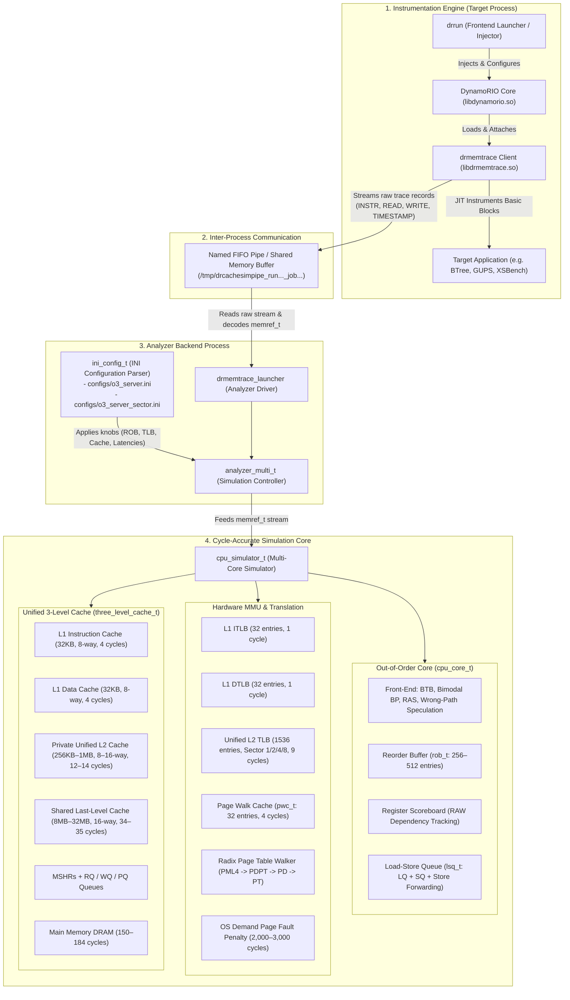
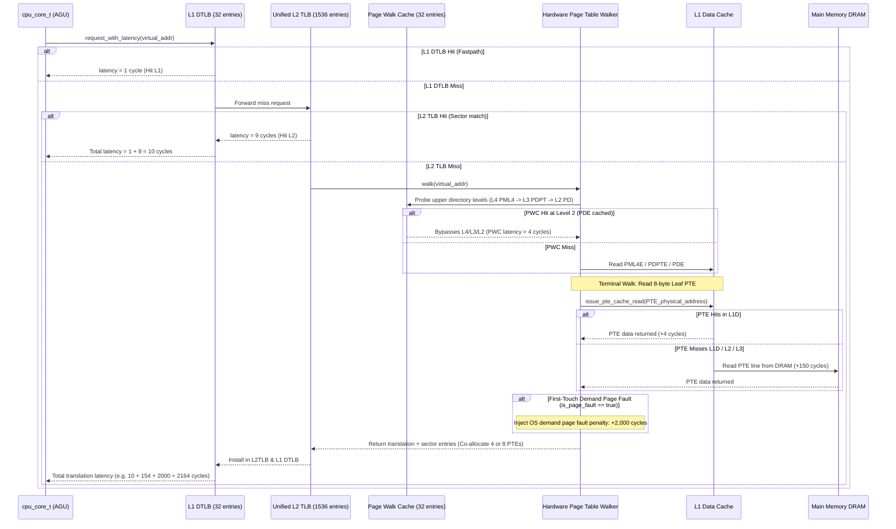

# DynamoRIO End-to-End Simulation Architecture: CPU, MMU, and `drrun` Integration

This document provides a comprehensive architectural guide detailing how the DynamoRIO runtime (`drrun`), the dynamic memory tracing client (`drmemtrace`), the analyzer frontend (`drmemtrace_launcher`), the cycle-level Out-of-Order CPU core (`cpu_core_t`), the hardware MMU / TLB subsystem, and the unified 3-level cache hierarchy connect together to execute cycle-accurate simulations.

---

## 1. High-Level Architecture Overview

The simulation stack is decoupled into four cooperating layers:



---

## 2. End-to-End Execution Walkthrough

When you invoke a simulation using `drrun`:
```bash
./build/bin64/drrun -t drmemtrace -simulator_type cpu -cpu_config configs/o3_server_sector.ini -- ./apps/BTree 100000 10000
```

The execution proceeds through the following sequential phases:

### Phase 1: Process Creation and JIT Instrumentation
1. **Frontend Invocation**: `build/bin64/drrun` parses command-line flags. The `-t drmemtrace` argument instructs it to load the memory tracing client configuration from `build/drmemtrace.drrun64`.
2. **Process Injection**: `drrun` launches the target application (`./apps/BTree`) in a paused state and injects the core runtime library `libdynamorio.so`.
3. **Client Initialization**: `libdynamorio.so` initializes the client plugin `build/lib64/release/libdrmemtrace.so`.
4. **Dynamic Basic-Block Instrumentation**: As the application executes native x86-64 code, DynamoRIO intercepts control flow and passes every basic block to `drmemtrace`'s instrumentation callback:
   - For every instruction fetch: emits a `TRACE_TYPE_INSTR` record with virtual address (`PC`), size, and thread ID (`TID`).
   - For every memory load: emits a `TRACE_TYPE_READ` record with data address, size, and PC.
   - For every memory store: emits a `TRACE_TYPE_WRITE` record with destination address and size.

### Phase 2: Inter-Process Communication (IPC Stream)
1. **FIFO Pipe Setup**: In online simulation mode, `drrun` creates a named FIFO pipe in `/tmp` (e.g. `/tmp/drcachesimpipe_...`).
2. **Backend Analyzer Spawn**: `drrun` spawns `build/bin64/drmemtrace_launcher` as a background process, connecting its standard input to the named pipe.
3. **Trace Compression/Buffering**: The client thread writes raw trace records into thread-local buffers. When full, buffers are flushed into the IPC pipe.

### Phase 3: Configuration Parsing & Simulator Instantiation
1. **CLI Ingestion**: `drmemtrace_launcher` initializes [`clients/drcachesim/analyzer_multi.cpp`](file:///media/pravesh/Storage/code/dyn/dynamorio/clients/drcachesim/analyzer_multi.cpp).
2. **Option Routing**: The option `-simulator_type cpu` routes execution to the `CPU_SIMULATOR` branch.
3. **Configuration Loading**: 
   - [`ini_config_t::load()`](file:///media/pravesh/Storage/code/dyn/dynamorio/clients/drcachesim/simulator/cpu/ini_parser.cpp#L131-L220) loads `configs/o3_server_sector.ini`.
   - It automatically resolves nested includes (`include = o3_default.ini`).
   - If relative, it searches relative to the working directory, DynamoRIO root (`dr_root`), `/proc/self/exe`, and `REPO_ROOT`.
   - If the file cannot be opened, it emits a `FATAL ERROR` and aborts rather than falling back to incorrect defaults.
4. **Knob Application**: `ini_parser.apply_to_knobs(knobs)` configures all hardware structures:
   - `rob_capacity = 512`, `lq_capacity = 128`, `sq_capacity = 96`
   - `l2_tlb_sector_size = 8`, `l2_tlb_entries = 1536`, `l2_tlb_assoc = 6`
   - `page_fault_penalty = 2000`, `dram_latency = 150`
5. **Tool Creation**: Calls [`cpu_simulator_create(knobs)`](file:///media/pravesh/Storage/code/dyn/dynamorio/clients/drcachesim/simulator/cpu/cpu_simulator.cpp#L830-L835), instantiating `cpu_simulator_t`.

---

## 3. Subsystem Breakdown

### 3.1. Out-of-Order CPU Core Subsystem ([`cpu_core_t`](file:///media/pravesh/Storage/code/dyn/dynamorio/clients/drcachesim/simulator/cpu/cpu_core.h))

Each simulated core maintains an independent cycle-accurate out-of-order execution pipeline:

```text
[Instruction Stream] ──> [Front-End: BTB & Predictor]
                                  │
                                  ▼
                         [Dispatch Stage]
                                  │
         ┌────────────────────────┼────────────────────────┐
         ▼                        ▼                        ▼
  [Scoreboard]             [Reorder Buffer]      [Load-Store Queue]
  (RAW Hazards)             (ROB: 512 slots)     (LQ: 128 / SQ: 96)
         │                        │                        │
         └────────────────────────┼────────────────────────┘
                                  ▼
                         [Execution Stage]
                                  │
               ┌──────────────────┴──────────────────┐
               ▼                                     ▼
        [ALU Operations]                     [Memory Operations]
        (alu_latency = 1)                 ┌──────────┴──────────┐
                                          ▼                     ▼
                                    [Store Forwarding]     [DTLB + Cache]
                                          │                     │
                                          └──────────┬──────────┘
                                                     ▼
                                            [Writeback Stage]
                                                     │
                                                     ▼
                                            [In-Order Commit]
                                                     │
                                                     ▼
                                           [Store Drain to L1D]
```

1. **Front-End & Branch Prediction**:
   - Compares successive instruction addresses. If `PC` branches, it queries the Branch Target Buffer (`btb_t`) backed by 2-bit bimodal saturating counters.
   - On a branch misprediction, it triggers `branch_recovery_until_cycle_` and spawns speculative instructions along the wrong path to realistically pollute L1I cache and TLB before squashing them.
2. **Scoreboard & Hazard Resolution**:
   - `register_scoreboard_t` tracks source/destination register readiness, accurately delaying instruction issue until all source registers are marked ready by producing instructions.
3. **Reorder Buffer (ROB)**:
   - Instructions enter the ROB in program order at Dispatch (`rob_.dispatch()`).
   - Instructions complete out of order at `completion_cycle` and set `ready_for_commit = true`.
   - Retirement is strictly in program order (`rob_.commit()`). If the instruction at the head of the ROB is stalled on an L2TLB miss or page fault, head-of-line blocking stalls all subsequent commits.
4. **Load-Store Queue (LSQ)**:
   - Stores allocate in the Store Queue (SQ) and compute addresses via DTLB.
   - Loads allocate in the Load Queue (LQ) and probe older stores in the SQ for **Store-to-Load Forwarding** (`lsq_.check_store_forwarding()`). If an address matches, the load completes in 1 cycle bypass without accessing cache.

---

### 3.2. Hardware MMU & Address Translation Subsystem

Address translation mirrors modern x86-64 hardware translation coupled to the CPU pipeline:



#### Key MMU Mechanisms:
- **Unified L2 TLB Sectored Co-Allocation**:
  In sector mode (`sector_size = 2, 4, 8`), a single L2 TLB tag covers an aligned block of virtual pages. When a PTW walk finishes, `page_table.cpp` fetches the entire chunk of adjacent leaf PTEs and installs them in a single sector entry. Subsequent accesses to adjacent pages hit immediately in L2 TLB (10 cycles) without walking the radix tree!
- **Page Walk Cache (PWC)**:
  Caches intermediate page directory addresses (PML4E, PDPTE, PDE). Across sequential or localized workloads, `PWC hits` reach $>99\%$, eliminating all upper directory memory reads.
- **PTW-to-Data-Cache Coupling**:
  PTE reads are routed directly through `L1D -> L2 -> L3 -> DRAM`. If leaf PTEs are shared or cached, the walker hits in L1D in 4 cycles instead of going to DRAM.
- **OS Demand Page Fault Penalty**:
  When a page is touched for the first time (`local_result.is_page_fault == true`), the walker adds `page_fault_penalty` (default 2,000 cycles) to the latency, accurately reflecting kernel page allocation, page clearing (`clear_page`), and exception servicing.

---

### 3.3. 3-Level Cache Hierarchy Subsystem ([`three_level_cache_t`](file:///media/pravesh/Storage/code/dyn/dynamorio/clients/drcachesim/simulator/cpu/three_level_cache.h))

The cache hierarchy models realistic non-blocking caches, Miss Status Holding Registers (MSHRs), and structural queues:

1. **Hierarchy Levels**:
   - **L1I**: Private 32KB, 8-way, 1–4 cycle hit latency.
   - **L1D**: Private 32KB, 8-way, 4 cycle hit latency.
   - **L2**: Private unified 256KB–1MB, 8–16-way, 12–14 cycle hit latency.
   - **L3 / LLC**: Shared unified 8MB–32MB, 16-way, 34–35 cycle hit latency.
   - **DRAM**: Main memory backing store (150–184 cycle latency).
2. **MSHR Operation (`mshr_table_t`)**:
   - On a cache miss, an MSHR entry is allocated to track the in-flight line fill.
   - If subsequent accesses target the same in-flight cache line, they are coalesced as **secondary misses** without generating additional downstream memory traffic.
   - If all MSHRs are occupied, the cache asserts backpressure stalls (`full_stalls`).
3. **Cache Queues (`cache_queue_t`)**:
   - **Read Queue (RQ)**: Buffers incoming demand loads.
   - **Write Queue (WQ)**: Buffers committed store writebacks and coalesces consecutive writes to the same cache block.
   - **Prefetch Queue (PQ)**: Buffers hardware prefetch requests.

---

## 4. End-to-End Statistics Generation

When simulation completes, [`cpu_simulator_t::print_csv_stats()`](file:///media/pravesh/Storage/code/dyn/dynamorio/clients/drcachesim/simulator/cpu/cpu_simulator.cpp#L320-L420) drains in-flight instructions and writes the structured metrics to the designated `-stats_file`:

```csv
config_file, configs/o3_server_sector.ini
commit_id, 3f3bf024a88da044521390ae74a448d7fff8ed3a
num_cores, 1
fetch_width, 8
decode_width, 8
dispatch_width, 8
commit_width, 8
rob_capacity, 512
lq_capacity, 128
sq_capacity, 96
btb_entries, 4096
branch_mispredict_penalty, 14
alu_latency, 1
enable_wrong_path, 1
max_speculative_depth, 32
line_size, 64
l1i_size, 32768
l1i_assoc, 8
l1i_latency, 4
l1i_mshr_capacity, 16
l1i_rq_capacity, 32
l1i_pq_capacity, 32
l1d_size, 32768
l1d_assoc, 8
l1d_mshr_capacity, 16
l1d_rq_capacity, 32
l1d_wq_capacity, 32
l1d_pq_capacity, 32
l2_size, 1048576
l2_assoc, 16
l2_mshr_capacity, 64
l2_rq_capacity, 48
l2_wq_capacity, 48
l2_pq_capacity, 32
l3_size, 33554432
l3_assoc, 16
l3_mshr_capacity, 128
l3_rq_capacity, 64
l3_wq_capacity, 64
l3_pq_capacity, 64
page_size, 4096
pwc_entries, 32
pwc_assoc, 4
l2_tlb_entries, 1536
l2_tlb_assoc, 6
l2_tlb_sector_size, 8
dram_latency, 150
page_fault_penalty, 2000
sim_refs, 0
heartbeat_interval, 10000000
-------------------------------------------------------------------
ipc, 0.4285
cpi, 2.3337
cycles, 128450123
instructions_retired, 55041920
instructions_fetched, 55198421
loads, 12048591
stores, 42993329
branch_squash_cycles, 184920
icache_miss_stall_cycles, 412039
itlb_miss_stall_cycles, 201490
page_fault_stall_cycles, 1420000
BP branches, 3491023
BP mispredicted, 13208
BP misprediction rate, 0.0038
ROB capacity, 512
ROB dispatches, 55394102
ROB commits, 55041920
ROB squashes, 352182
ROB head stalls, 4920194
LSQ loads, 12194021
LSQ stores, 43200081
LSQ forwardings, 492011
WP branches handled, 13208
WP instrs fetched, 422656
WP instrs squashed, 352182
WP loads executed, 145430
WP stores buffered, 66752
L1I hits, ...
L1D hits, ...
L2 hits, ...
LLC hits, ...
LLC, labels of histogram of power of 2, 0, 1, 2, 3-4, 5-8, 9-16, 17-32, 33-64, 65-128, 129-256, 257-512, 513-1024, >1024, inf
LLC, event countof histogram power of 2, ...
L2TLB hits, 419204
L2TLB misses, 1294
L2TLB sector size, 8
L2TLB sector tag hits, 419204
L2TLB sector tag misses, 1294
L2TLB sector subentry misses, 0
PTW walks, 1294
PTW 4KB walks, 1294
PTW page faults, 710
PTW page fault penalty, 2000
PWC hits, 1290
PWC misses, 4
Avg PTW mem reads, 1.0031
cpu0,ptw_level0, L1I,L1D,L2,LLC,DRAM
cpu0,ptw_level0, 0, 1200, 30, 2, 62
completion_time, 2026-10-28 01:15:32
duration, 00:24:18
```

---

## 5. Summary of Key Files

| Subsystem | Source Path | Description |
| :--- | :--- | :--- |
| **Frontend Launcher** | [`build/bin64/drrun`](file:///media/pravesh/Storage/code/dyn/dynamorio/build/bin64/drrun) | Injects DynamoRIO and coordinates the online tracer and analyzer pipe. |
| **Tracer Client** | [`clients/drcachesim/tracer/`](file:///media/pravesh/Storage/code/dyn/dynamorio/clients/drcachesim/tracer/) | JIT-instruments app instructions, memory reads, and writes; writes to IPC pipe. |
| **Analyzer Frontend** | [`clients/drcachesim/launcher.cpp`](file:///media/pravesh/Storage/code/dyn/dynamorio/clients/drcachesim/launcher.cpp) | Reads FIFO pipe, unpacks binary records into `memref_t`. |
| **Simulation Controller** | [`clients/drcachesim/analyzer_multi.cpp`](file:///media/pravesh/Storage/code/dyn/dynamorio/clients/drcachesim/analyzer_multi.cpp) | Manages INI loading, option validation, and tool instantiation (`cpu_simulator_t`). |
| **INI Parser** | [`clients/drcachesim/simulator/cpu/ini_parser.cpp`](file:///media/pravesh/Storage/code/dyn/dynamorio/clients/drcachesim/simulator/cpu/ini_parser.cpp) | Hierarchical INI lexing, unit conversion (`KB`, `MB`), nested includes, and fallback path discovery. |
| **OoO Pipeline** | [`clients/drcachesim/simulator/cpu/cpu_core.cpp`](file:///media/pravesh/Storage/code/dyn/dynamorio/clients/drcachesim/simulator/cpu/cpu_core.cpp) | Cycle-level superscalar out-of-order execution pipeline, ROB, scoreboard, LSQ. |
| **Hardware MMU** | [`clients/drcachesim/simulator/mmu/page_table_walker.cpp`](file:///media/pravesh/Storage/code/dyn/dynamorio/clients/drcachesim/simulator/mmu/page_table_walker.cpp) | 4-level radix PTW, Page Walk Cache, coupled L1D cache reads, and OS page fault penalty. |
| **TLB Hierarchy** | [`clients/drcachesim/simulator/tlb.cpp`](file:///media/pravesh/Storage/code/dyn/dynamorio/clients/drcachesim/simulator/tlb.cpp) | L1 ITLB, L1 DTLB, and unified sectored L2 TLB (sector sizes 1, 2, 4, 8). |
| **3-Level Cache** | [`clients/drcachesim/simulator/cpu/three_level_cache.cpp`](file:///media/pravesh/Storage/code/dyn/dynamorio/clients/drcachesim/simulator/cpu/three_level_cache.cpp) | Private L1I/L1D, unified L2, shared LLC, MSHR tables, and cache queues. |
| **Job Dispatcher** | [`scripts/run_jobfile.sh`](file:///media/pravesh/Storage/code/dyn/dynamorio/scripts/run_jobfile.sh) | Concurrent process pooling, unique pipe names, working directory isolation, and result aggregation. |
