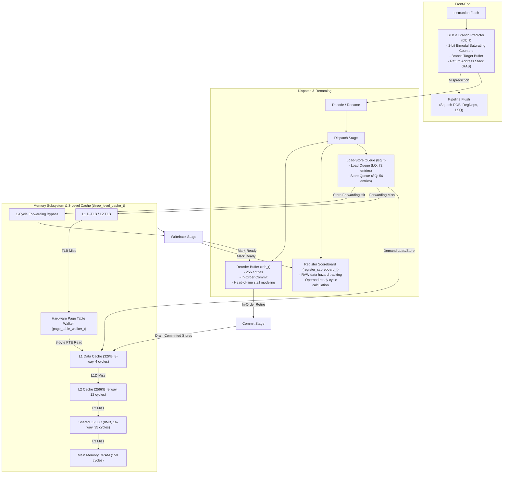

# Out-of-Order (OoO) CPU Core & 3-Level Cache Hierarchy Simulator (`drcachesim/simulator/cpu`)

## 1. Overview

This directory (`clients/drcachesim/simulator/cpu/`) provides a full cycle-level **Out-of-Order (OoO) superscalar CPU core pipeline**, **Front-End (BTB + Branch Predictor + RAS)**, **Reorder Buffer (ROB)**, **Register Dependency Scoreboard**, **Load-Store Queue (LSQ)** with **Store-to-Load Forwarding**, and a **Unified 3-Level Data Cache Hierarchy (`L1D -> L2 -> L3/LLC -> DRAM`)** through which both application demand accesses and hardware Page Table Walks (PTW on Page Walk Cache misses) flow.

---

## 2. Component Architecture



---

## 3. Class Hierarchy & Source Files

```text
clients/drcachesim/simulator/cpu/
├── cpu_types.h          # cpu_op_type_t, pipeline_stage_t, branch_prediction_t, dyn_instruction_t
├── three_level_cache.h  # 3-level data cache hierarchy declaration (L1D -> L2 -> L3/LLC)
├── three_level_cache.cpp# Cascading cache lookups, PTW PTE routing, and access latency evaluation
├── btb.h                # btb_t, return_address_stack_t, and branch_predictor_t declarations
├── btb.cpp              # 2-bit saturating counter branch direction and target prediction
├── reg_deps.h           # register_scoreboard_t declaration
├── reg_deps.cpp         # Register dependency tracking, RAW hazard detection, and writeback publishing
├── rob.h                # rob_t declaration
├── rob.cpp              # Reorder Buffer: circular FIFO, in-order commit, head-of-line stalls, squashes
├── lsq.h                # lsq_t declaration
├── lsq.cpp              # Load-Store Queue: store-to-load forwarding and store buffering until commit
├── wrong_path.h         # Speculative wrong-path execution engine declaration
├── wrong_path.cpp       # Wrong-path instruction stream synthesis, cache/TLB pollution, and squashes
├── cpu_core.h           # cpu_core_t declaration
├── cpu_core.cpp         # Complete out-of-order execution pipeline engine
├── cpu_simulator.h      # cpu_simulator_t declaration
├── cpu_simulator.cpp    # Multi-core CPU simulator tool
└── README.md            # Architecture documentation (this file)
```

---

## 4. Key Mechanisms

### 4.1 Store-to-Load Forwarding & Disambiguation (`lsq_t`)
- When a load executes, `lsq_t::check_store_forwarding()` scans the Store Queue backwards for preceding in-flight stores (`store.seq_id < load.seq_id`).
- If an exact address match occurs, the store forwards its data directly to the load in **1 cycle**, completely bypassing DTLB, L1D, and main memory!
- Stores buffer in the SQ and **only drain to L1D cache at in-order commit time**, preserving memory consistency.

### 4.2 Reorder Buffer Head-of-Line Stalls (`rob_t`)
- Instructions dispatch in program order into the ROB.
- Execution happens out-of-order as register and memory operands become ready.
- At commit time, retirement is strictly in program order from the head of the ROB.
- If the instruction at the head is a Load waiting on an L1D miss, L2 miss, or Page Table Walk, the ROB head blocks, preventing younger ready instructions from committing.

### 4.3 Unified 3-Level Cache Hierarchy (`three_level_cache_t`)
- **Split L1 Harvard Architecture**: Each core features a private **L1 Instruction Cache (`L1I`)** and private **L1 Data Cache (`L1D`)**.
- **Unified Lower Levels**: Both `L1I` and `L1D` miss into the core's private unified **L2 Cache** (`L1I.parent_ = L2`, `L1D.parent_ = L2`). All per-core L2 caches miss into the shared unified **L3 / LLC Cache** (`L2.parent_ = L3`), which connects to main memory DRAM (`L3.parent_ = nullptr`).
- **Instruction Fetch Stalls**: Instruction fetches flow through `L1I`. On an L1I miss, the CPU Front-End incurs fetch stall cycles (`icache_res.latency_cycles`) while the line is filled from L2, L3, or DRAM.
- **PTW and Demand Traffic**: Both demand memory accesses (`TRACE_TYPE_READ` / `TRACE_TYPE_WRITE`) and hardware Page Table Walker 8-byte PTE memory reads (`ptw_request()`) traverse the exact same cache sets in `L1D`, `L2`, and `L3`.
- Models cache contention and cache pollution caused by page table walks upon Page Walk Cache misses.

### 4.4 Speculative Wrong-Path Execution (`speculative_wrong_path_engine_t`)
- When a branch mispredicts in `cpu_core_t`, the processor does **not** simply stall idle.
- The pipeline fetches, decodes, and dispatches instructions along the **mispredicted path** (starting at the wrong target or fallthrough PC) for the duration of the branch resolution penalty (default: 14 cycles).
- **Buffer Occupancy**: Wrong-path instructions consume physical ROB slots, scoreboard registers, and Load/Store Queue entries.
- **Speculative Cache & TLB Pollution**: Speculative loads access L1D, L2, L3, and the DTLB. Cold cache lines are brought from DRAM into the hierarchy.
- **Architectural Store Safety**: Speculative stores buffer in the SQ, but **never commit to cache** because commit is strictly in program order.
- **Squash on Resolution**: When the branch resolves, `cpu_core_t` calls `rob_.squash_after()`, `scoreboard_.squash_after()`, and `lsq_.squash_after()`. All wrong-path instructions are discarded, but the **cache lines and TLB translations they loaded remain in hardware** (faithfully modeling Spectre-style speculative side effects).
