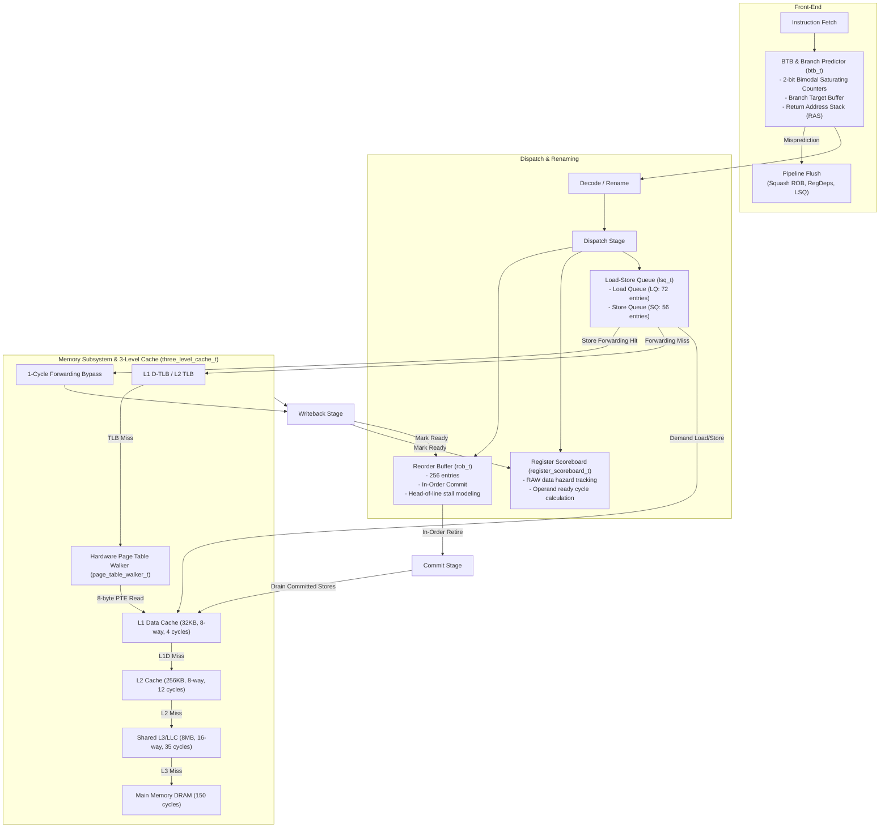

# Out-of-Order (OoO) CPU Core & 3-Level Cache Hierarchy Simulator (`drcachesim/simulator/cpu`)

## 1. Overview

This directory (`clients/drcachesim/simulator/cpu/`) provides a full cycle-level **Out-of-Order (OoO) superscalar CPU core pipeline**, **Front-End (BTB + Branch Predictor + RAS)**, **Reorder Buffer (ROB)**, **Register Dependency Scoreboard**, **Load-Store Queue (LSQ)** with **Store-to-Load Forwarding**, and a **Unified 3-Level Data Cache Hierarchy (`L1D -> L2 -> L3/LLC -> DRAM`)** through which both application demand accesses and hardware Page Table Walks (PTW on Page Walk Cache misses) flow.

---

## 2. Component Architecture



---

## 3. Class Hierarchy & Source Files

```text
clients/drcachesim/simulator/cpu/
├── cpu_types.h          # cpu_op_type_t, pipeline_stage_t, branch_prediction_t, dyn_instruction_t
├── three_level_cache.h  # 3-level data cache hierarchy declaration (L1D -> L2 -> L3/LLC)
├── three_level_cache.cpp# Cascading cache lookups, PTW PTE routing, and access latency evaluation
├── btb.h                # btb_t, return_address_stack_t, and branch_predictor_t declarations
├── btb.cpp              # 2-bit saturating counter branch direction and target prediction
├── reg_deps.h           # register_scoreboard_t declaration
├── reg_deps.cpp         # Register dependency tracking, RAW hazard detection, and writeback publishing
├── rob.h                # rob_t declaration
├── rob.cpp              # Reorder Buffer: circular FIFO, in-order commit, head-of-line stalls, squashes
├── lsq.h                # lsq_t declaration
├── lsq.cpp              # Load-Store Queue: store-to-load forwarding and store buffering until commit
├── wrong_path.h         # Speculative wrong-path execution engine declaration
├── wrong_path.cpp       # Wrong-path instruction stream synthesis, cache/TLB pollution, and squashes
├── cpu_core.h           # cpu_core_t declaration
├── cpu_core.cpp         # Complete out-of-order execution pipeline engine
├── cpu_simulator.h      # cpu_simulator_t declaration
├── cpu_simulator.cpp    # Multi-core CPU simulator tool
└── README.md            # Architecture documentation (this file)
```

---

## 4. Key Mechanisms

### 4.1 Store-to-Load Forwarding & Disambiguation (`lsq_t`)
- When a load executes, `lsq_t::check_store_forwarding()` scans the Store Queue backwards for preceding in-flight stores (`store.seq_id < load.seq_id`).
- If an exact address match occurs, the store forwards its data directly to the load in **1 cycle**, completely bypassing DTLB, L1D, and main memory!
- Stores buffer in the SQ and **only drain to L1D cache at in-order commit time**, preserving memory consistency.

### 4.2 Reorder Buffer Head-of-Line Stalls (`rob_t`)
- Instructions dispatch in program order into the ROB.
- Execution happens out-of-order as register and memory operands become ready.
- At commit time, retirement is strictly in program order from the head of the ROB.
- If the instruction at the head is a Load waiting on an L1D miss, L2 miss, or Page Table Walk, the ROB head blocks, preventing younger ready instructions from committing.

### 4.3 Unified 3-Level Cache Hierarchy (`three_level_cache_t`)
- **Split L1 Harvard Architecture**: Each core features a private **L1 Instruction Cache (`L1I`)** and private **L1 Data Cache (`L1D`)**.
- **Unified Lower Levels**: Both `L1I` and `L1D` miss into the core's private unified **L2 Cache** (`L1I.parent_ = L2`, `L1D.parent_ = L2`). All per-core L2 caches miss into the shared unified **L3 / LLC Cache** (`L2.parent_ = L3`), which connects to main memory DRAM (`L3.parent_ = nullptr`).
- **Instruction Fetch Stalls**: Instruction fetches flow through `L1I`. On an L1I miss, the CPU Front-End incurs fetch stall cycles (`icache_res.latency_cycles`) while the line is filled from L2, L3, or DRAM.
- **PTW and Demand Traffic**: Both demand memory accesses (`TRACE_TYPE_READ` / `TRACE_TYPE_WRITE`) and hardware Page Table Walker 8-byte PTE memory reads (`ptw_request()`) traverse the exact same cache sets in `L1D`, `L2`, and `L3`.
- Models cache contention and cache pollution caused by page table walks upon Page Walk Cache misses.

### 4.4 Speculative Wrong-Path Execution (`speculative_wrong_path_engine_t`)
- When a branch mispredicts in `cpu_core_t`, the processor does **not** simply stall idle.
- The pipeline fetches, decodes, and dispatches instructions along the **mispredicted path** (starting at the wrong target or fallthrough PC) for the duration of the branch resolution penalty (default: 14 cycles).
- **Buffer Occupancy**: Wrong-path instructions consume physical ROB slots, scoreboard registers, and Load/Store Queue entries.
- **Speculative Cache & TLB Pollution**: Speculative loads access L1D, L2, L3, and the DTLB. Cold cache lines are brought from DRAM into the hierarchy.
- **Architectural Store Safety**: Speculative stores buffer in the SQ, but **never commit to cache** because commit is strictly in program order.
- **Squash on Resolution**: When the branch resolves, `cpu_core_t` calls `rob_.squash_after()`, `scoreboard_.squash_after()`, and `lsq_.squash_after()`. All wrong-path instructions are discarded, but the **cache lines and TLB translations they loaded remain in hardware** (faithfully modeling Spectre-style speculative side effects).

### 4.5 ChampSim & CloudSuite Google Trace Reader (`champsim_trace_reader_t`)
- **Standard ChampSim Format (64-byte records)**:
  - Binary instruction record: `uint64_t ip`, `uint8_t is_branch`, `uint8_t branch_taken`, `uint8_t destination_registers[2]`, `uint8_t source_registers[4]`, `uint64_t destination_memory[2]`, `uint64_t source_memory[4]`.
  - Used by Google Datacenter benchmark callsets (e.g., `bc-0`, `bfs-10`, `cc-13`, `sssp-10`, `nutch_phase0_core1`).
- **CloudSuite Format (96-byte records)**:
  - Extended binary record with `destination_registers[4]`, `destination_memory[4]` (up to 4 memory stores per instruction), `source_memory[4]`, and `asid[2]` (Address Space Identifier).
  - Used by CloudSuite server and multi-process workloads.
- **Decompression**: Automatic streaming decompression via parallel pipelines for `.gz`, `.xz`, and `.bz2` traces, as well as uncompressed `.trace` binary files.
- **Trace Format Flags**:
  - `-champsim_format <default|standard|cloudsuite|auto>`: Explicit command-line flag indicating trace layout.
    - `default` / `standard` / `64`: Standard 64-byte ChampSim format (2 stores, 4 loads).
    - `cloudsuite` / `cs` / `96`: CloudSuite 96-byte format (4 stores, 4 loads, ASID).
    - `auto`: Heuristic auto-detection based on sequential instruction stride scoring.
  - `-is_cloudsuite`: Convenient boolean shortcut flag indicating CloudSuite 96-byte format.
- **DynamoRIO Unpacking**: Maps binary records into program-order `TRACE_TYPE_INSTR` fetch events, followed by all valid `TRACE_TYPE_READ` loads and `TRACE_TYPE_WRITE` stores, allowing seamless trace playback directly through `cpu_simulator_t::process_memref()`.

---

## 5. Usage: Running Traces & Applications through the O3 Engine

### 5.0 Fast Build Instructions (1 Command)

You can compile the simulator and all unit tests in parallel in under 3 seconds:

```bash
# Build both bin/run_cpu_sim and bin/unit_tests:
./build.sh         # (or: make -j$(nproc))

# Run the full unit test suite (13 tests):
./build.sh test    # (or: make test)

# Clean build artifacts:
./build.sh clean   # (or: make clean)
```

---

### 5.1 Running Live Applications Online with DynamoRIO (`drrun`)

**Does online application simulation require two steps?**
**No. It is 100% automatic in a single command.**

In online mode, DynamoRIO instruments the application in memory and streams instructions and memory references directly into our O3 CPU pipeline via shared-memory ring buffers. **Zero trace files are written to disk.**

#### Basic Single-Step Invocation:
```bash
# Run any Linux binary live through our Out-of-Order CPU simulator:
bin64/drrun -t drmemtrace -simulator_type cpu -- /path/to/my_application [args...]
```
*(Note: `-t drmemtrace` and `-t drcachesim` are identical aliases; both point to the same launcher).*

#### Customizing the O3 CPU Core & Cache Parameters for Live Apps:
```bash
bin64/drrun -t drmemtrace -simulator_type cpu \
  -num_cores 1 \
  -L1I_size 32K \
  -L1D_size 32K \
  -LL_size 256K \
  -L3_size 8M \
  -TLB_pwc_entries 32 \
  -- /bin/ls -la
```
When the target application terminates, the O3 pipeline drains all pending stores to cache and prints full pipeline, ROB, LSQ, and cache statistics to `stdout`.

---

### 5.2 Running Saved Google Datacenter & ChampSim Traces (`bin/run_cpu_sim`)

To simulate existing binary traces (`.trace`, `.gz`, `.xz`) directly without DynamoRIO runtime overhead, use the standalone driver [`bin/run_cpu_sim`](file:///media/pravesh/Storage/code/dyn/dynamorio/clients/drcachesim/simulator/cpu/run_cpu_sim.cpp):

#### A. Running CloudSuite 96-Byte Traces (4 stores, 4 loads, ASID):
```bash
./bin/run_cpu_sim \
  --trace /media/pravesh/Storage/ALL_TRACES/nutch_phase0_core1.trace.xz \
  --format cloudsuite \
  --max_instrs 1000000 \
  --rob_size 256 \
  --lq_size 72 \
  --sq_size 56
```

#### B. Running Standard 64-Byte ChampSim Traces:
```bash
./bin/run_cpu_sim \
  --trace /media/pravesh/Storage/ALL_TRACES/bc-0.trace.gz \
  --format standard \
  --max_instrs 1000000
```

#### C. Running Traces with Automatic Stride Detection:
```bash
./bin/run_cpu_sim \
  --trace /media/pravesh/Storage/ALL_TRACES/llama2.c-stories110M.1.champsimtrace.gz \
  --max_instrs 500000
```

---

### 5.3 Optional Two-Step Offline Tracing & Replay

If you want to record an execution trace once and replay it repeatedly across different microarchitectural configurations (e.g. comparing 128 vs 256 ROB entries or 32KB vs 64KB L1D):

```bash
# Step 1: Record offline compressed trace with physical address mappings
bin64/drrun -t drmemtrace -offline -record_replace_retaddr -use_physical \
  -outdir /tmp/my_app_trace -- ./my_application arg1 arg2

# Step 2: Replay through our Out-of-Order CPU engine
bin64/drrun -t drmemtrace -simulator_type cpu \
  -indir /tmp/my_app_trace/drmemtrace.my_application.*.dir \
  -v2p_file /tmp/my_app_trace/drmemtrace.my_application.*.dir/v2p.log \
  -TLB_enable_ptw true \
  -TLB_enable_huge_pages true \
  -TLB_pwc_entries 32 \
  -TLB_couple_ptw_dcache true
```

---

### 5.4 Programmatic C++ Simulation Driver

You can also embed the complete simulator in any C++ tool or benchmark suite:

```cpp
#include "cpu/cpu_simulator.h"
#include "reader/champsim_reader.h"
#include <iostream>

using namespace dynamorio::drmemtrace;

int main() {
    // 1. Configure CPU pipeline and cache hierarchy knobs:
    cpu_simulator_knobs_t knobs;
    knobs.num_cores = 1;
    knobs.fetch_width = 4;
    knobs.commit_width = 4;
    knobs.rob_capacity = 256;
    knobs.lq_capacity = 72;
    knobs.sq_capacity = 56;
    knobs.enable_wrong_path = true;
    knobs.branch_mispredict_penalty = 14;
    knobs.l1i_size = 32 * 1024; // 32 KB private L1I
    knobs.l1d_size = 32 * 1024; // 32 KB private L1D
    knobs.l2_size = 256 * 1024; // 256 KB private L2
    knobs.l3_size = 8 * 1024 * 1024; // 8 MB shared L3

    // 2. Instantiate simulator:
    cpu_simulator_t sim(knobs);

    // 3. Open trace (auto-detects .gz/.xz compression and 64B/96B layout):
    champsim_trace_reader_t reader(
        "/media/pravesh/Storage/ALL_TRACES/nutch_phase0_core1.trace.xz",
        champsim_trace_format_t::FORMAT_CLOUDSUITE);
    
    if (!reader.open()) {
        std::cerr << "Failed to open trace\n";
        return 1;
    }

    // 4. Run 1,000,000 instructions:
    reader.run_simulation(sim, /*max_instructions=*/1000000, /*print_interval=*/100000);

    // 5. Print comprehensive statistics:
    sim.print_results();
    return 0;
}
```

---

## 6. Simulation Knobs & Options Reference

| Option | Flag in `run_cpu_sim` | drcachesim Flag | Default | Description |
|---|---|---|---|---|
| Trace Path | `--trace <path>` | `-champsim_trace` | `""` | Path to trace file (`.trace`, `.gz`, `.xz`). |
| Trace Format | `--format <fmt>` | `-champsim_format` | `auto` | `default`, `standard`, `cloudsuite`, or `auto`. |
| CloudSuite Shortcut | `--is_cloudsuite` | `-is_cloudsuite` | `false` | Force 96-byte CloudSuite record layout. |
| Max Instructions | `--max_instrs <N>` | `-max_instructions` | `1000000` | Stop simulation after N instructions (0 = all). |
| Cores | `--cores <N>` | `-num_cores` | `1` | Number of independent CPU cores. |
| ROB Size | `--rob_size <N>` | `-rob_size` | `256` | Reorder Buffer capacity in entries. |
| Load Queue Size | `--lq_size <N>` | `-lq_size` | `72` | Load Queue capacity in entries. |
| Store Queue Size | `--sq_size <N>` | `-sq_size` | `56` | Store Queue capacity in entries. |
| BTB Size | `--btb_entries <N>` | `-btb_entries` | `4096` | Branch Target Buffer entries. |
| Mispredict Penalty | `--mispredict_penalty <N>` | `-branch_penalty` | `14` | Flush penalty cycles for branch mispredicts. |
| Wrong-Path Engine | `--enable_wrong_path <0\|1>`| `-enable_wrong_path` | `1` | Enable speculative wrong-path execution. |
| Speculative Depth | `--speculative_depth <N>`| `-speculative_depth` | `32` | Maximum wrong-path instructions fetched. |
| L1I Cache Size | `--l1i_size <bytes>` | `-L1I_size` | `32768` (32KB)| Private L1 Instruction Cache size. |
| L1D Cache Size | `--l1d_size <bytes>` | `-L1D_size` | `32768` (32KB)| Private L1 Data Cache size. |
| L2 Cache Size | `--l2_size <bytes>` | `-LL_size` | `262144` (256KB)| Private unified L2 Cache size. |
| L3 / LLC Size | `--l3_size <bytes>` | `-L3_size` | `8388608` (8MB)| Shared unified Last-Level Cache size. |
| PWC Entries | `--pwc_entries <N>` | `-TLB_pwc_entries` | `32` | Page Walk Cache entries per core. |

---

## 7. Understanding Simulation Statistics

When simulation finishes, `print_results()` displays a full breakdown across four core dimensions:

```text
===================================================================
       OUT-OF-ORDER CPU, MMU & 3-LEVEL CACHE SIMULATION RESULTS     
===================================================================
  Core #0 Out-of-Order CPU Pipeline stats:
    Total instructions fetched:            5000
    Total instructions retired:            6739
    Total loads:                           1355
    Total stores:                           384
    Branch squash penalty cycles:           798
    L1I cache miss stall cycles:          15048
    Total execution cycles:               22637
    Overall CPI:                         3.3591
    Overall IPC:                         0.2977
```
1. **Total execution cycles & IPC**:
   - Accurately tracks out-of-order execution overlap, structural stalls, head-of-line commit stalls, L1I fetch stalls, and branch misprediction flushes.
2. **Branch Predictor & BTB**:
   - Direction predictions via 2-bit bimodal saturating counters, target predictions via BTB, subroutine call/return pairing via RAS.
3. **Reorder Buffer (ROB)**:
   - Tracks dispatch saturation (`ROB full dispatch stalls`), in-order commits, and `Head-of-line commit stalls` (younger ready instructions blocked waiting for an older load to return from cache/memory).
4. **Load-Store Queue (LSQ)**:
   - Disambiguates memory operations, buffers speculative stores, and counts `Store-to-Load forwardings` (where load retrieves data from an in-flight store in 1 cycle, bypassing cache and TLB entirely).
5. **Speculative Wrong-Path Execution**:
   - Shows instructions fetched along the wrong path upon misprediction, speculative loads/stores issued, and **speculative cache and L1I pollution** (lines brought into cache before the branch was resolved and squashed).
6. **3-Level Cache Hierarchy**:
   - Hits, misses, compulsory misses, and local/total miss rates across `L1I`, `L1D`, `L2`, and shared `L3/LLC`.
7. **MMU, PTW & Page Walk Cache**:
   - Total 4KB / 2MB / 1GB page table walks, demand page faults, PWC hits/misses, and PTW memory traffic hitting or missing in the data cache hierarchy.

