# Realistic MMU, Page Table Walk, and Multi-Page-Size TLB Simulation (`drcachesim/simulator/mmu`)

## 1. Overview

This directory (`clients/drcachesim/simulator/mmu/`) implements a full, hardware-realistic **Memory Management Unit (MMU)**, **4-Level Radix Page Table (`PML4 -> PDPT -> PD -> PT`)**, **Page Table Walker (`PTW`)**, **Page Walk Cache (`PWC`)**, **Huge-Page Detector (`4KB` / `2MB` / `1GB`)**, and **Coupled PTW-to-Data-Cache** engine for DynamoRIO's `drcachesim` TLB simulator (`tlb_simulator_t`).

Previously, `tlb_simulator_t` treated the L2 Unified TLB (`TLB_L2`) as a terminal level (`parent_ == nullptr`) where an L2 TLB miss simply incremented a miss counter and immediately installed a tag-only `tlb_entry_t` without storing a Physical Page Number (`PPN`), walking an OS page table, consulting a Page Walk Cache, or issuing physical memory accesses for Page Table Entries (`PTE`s) through the CPU data cache hierarchy.

With the `mmu/` subsystem integrated into `tlb_t` and `tlb_simulator_t`:
1. **`tlb_entry_t` stores full translations**: Virtual Page Number (`VPN` via `tag_`), Physical Page Number (`ppn_`), Process ID (`pid_`), `page_size_kind_t` (`4KB`, `2MB`, `1GB`), protection/status flags (`referenced_`, `dirty_`, `writable_`, `executable_`), and replacement state (`LRU` / `LFU` / `FIFO`).
2. **Per-PID 4-Level x86-64 Radix Page Table (`radix_page_table_t`)**: Dynamically constructs and queries `L4 (PML4) -> L3 (PDPT) -> L2 (PD) -> L1 (PT)` trees per process, backed by physical frames allocated from `physical_frame_allocator_t` or seeded from offline `v2p.textproto` mappings.
3. **Hardware Page Table Walker (`page_table_walker_t`) & Page Walk Cache (`page_walk_cache_t`)**: On every L2 TLB miss, the per-core `page_table_walker_t` probes its per-core `page_walk_cache_t` (`L3 -> L2 -> L1`) to skip upper radix levels and walks only the remaining levels down to the leaf (`L3 PDPTE` for `1GB`, `L2 PDE` for `2MB`, or `L1 PTE` for `4KB`).
4. **Coupled PTW-to-Data-Cache Simulation**: For each uncached PTW step (`8-byte` physical PTE address `table_pfn * 4096 + index * 8`), `page_table_walker_t` synthesizes a `TRACE_TYPE_READ` `memref_t` and injects it into a coupled CPU data cache (`cache_lru_t` or external `caching_device_t`), accurately modeling PTE cache hits/misses and data-cache pollution caused by TLB misses.
5. **Multi-Page-Size / Huge-Page Awareness (`huge_page_detector_t`)**: Detects `2MB` and `1GB` pages via `/proc/<pid>/smaps`, `/proc/kpageflags`, contiguous physical frame (`v2p`) alignment heuristics, or explicit region registration, and normalizes TLB tags in `tlb_t::request()` so all `512` `4KB` sub-pages inside a `2MB` page (or `262,144` `4KB` sub-pages inside a `1GB` page) share a single huge-page TLB entry and a shortened PTW.

---

## 2. Directory Structure & Object-Oriented Class Hierarchy

```text
clients/drcachesim/simulator/mmu/
├── mmu_types.h                  # Value types: mmu_constants_t, page_size_kind_t, ptw_level_t,
│                                #   page_size_helper_t, page_table_entry_t, ptw_step_record_t, ptw_result_t
├── physical_frame_allocator.h   # physical_frame_allocator_t declaration
├── physical_frame_allocator.cpp # 4KB/2MB/1GB physical frame allocator & free-lists
├── huge_page_detector.h         # huge_page_detector_t declaration
├── huge_page_detector.cpp       # Multi-source huge-page classifier (smaps, kpageflags, v2p heuristic)
├── page_table.h                 # radix_table_node_t, radix_page_table_t, mmu_address_space_manager_t
├── page_table.cpp               # 4-level radix page table implementation & demand-paging handler
├── page_walk_cache.h            # pwc_entry_t, page_walk_cache_t declaration
├── page_walk_cache.cpp          # Set-associative LRU Page Walk Cache for L4/L3/L2 entries
├── mmu_stats.h                  # mmu_stats_t declaration
├── mmu_stats.cpp                # Per-core MMU/PTW/PWC/page-fault/shootdown statistics
├── page_table_walker.h          # page_table_walker_t declaration
├── page_table_walker.cpp        # Hardware PTW state machine with coupled data-cache PTE reads
└── README.md                    # Architecture & usage documentation (this file)
```

### Architecture Diagram

```mermaid
flowchart TD
    MemRef["memref_t (Virtual Address, PID, TID, Type)"] --> CoreRouter["tlb_simulator_t::process_memref()"]
    CoreRouter -->|"IFETCH"| ITLB["L1 I-TLB (tlb_t / tlb_lru_t / tlb_fifo_t)"]
    CoreRouter -->|"READ / WRITE"| DTLB["L1 D-TLB (tlb_t / tlb_lru_t / tlb_fifo_t)"]
    ITLB -->|"L1 Miss"| L2TLB["L2 Unified TLB (tlb_t)"]
    DTLB -->|"L1 Miss"| L2TLB
    L2TLB -->|"L2 Miss (invoke PTW callback)"| PTW["Per-Core page_table_walker_t::walk()"]
    PTW -->|"1. Query Page Size"| HPD["huge_page_detector_t (4KB / 2MB / 1GB)"]
    PTW -->|"2. Probe Upper Levels"| PWC["Per-Core page_walk_cache_t (L4 / L3 / L2)"]
    PTW -->|"3. Walk Missing Levels"| RPT["Per-PID radix_page_table_t (PML4 -> PDPT -> PD -> PT)"]
    RPT -->|"Demand Page Fault"| PFA["physical_frame_allocator_t"]
    PTW -->|"4. Issue 8-byte Physical PTE Read"| DCache["Coupled Data Cache (caching_device_t)"]
    PTW -->|"5. Return ptw_result_t (PPN, page_size, latency)"| L2TLB
    L2TLB -->|"Install VPN->PPN & Propagate"| DTLB
```



---

## 3. Detailed Component Design

### 3.1 `mmu_types.h`
Defines foundational constants (`mmu_constants_t`), enums, and POD structures:
- **`page_size_kind_t`**: `PAGE_SIZE_4KB` (`12-bit` shift, `4,096` bytes), `PAGE_SIZE_2MB` (`21-bit` shift, `2,097,152` bytes), `PAGE_SIZE_1GB` (`30-bit` shift, `1,073,741,824` bytes).
- **`ptw_level_t`**: `PTW_LEVEL_1_PT` (`bits [20:12]`), `PTW_LEVEL_2_PD` (`bits [29:21]`), `PTW_LEVEL_3_PDPT` (`bits [38:30]`), `PTW_LEVEL_4_PML4` (`bits [47:39]`).
- **`page_size_helper_t`**: Inline static bit-extraction helpers (`extract_level_index()`, `align_down_page()`, `extract_base_pfn()`, `leaf_level_for_page_size()`).
- **`page_table_entry_t`**: Architectural 64-bit PTE metadata (`present`, `writable`, `user`, `accessed`, `dirty`, `huge_or_leaf`, `no_execute`, `next_or_leaf_pfn`, and `encode_arch_pte()`).
- **`ptw_step_record_t` & `ptw_result_t`**: Full trace of every level visited during a page table walk, including physical PTE address (`pte_phys_addr`), `pwc_hit`, `dcache_accessed`, `dcache_hit`, `leaf_ppn`, `resolved_page_size`, and `total_latency_cycles`.

### 3.2 `physical_frame_allocator_t`
Manages simulated physical memory frame allocation:
- Tracks a bump pointer (`next_unallocated_pfn_`), recycled free lists for `4KB`, `2MB` (`512-PFN` aligned), and `1GB` (`262,144-PFN` aligned) blocks, and an `externally_reserved_pfns_` set for PFNs imported from `v2p.textproto`.
- Provides `allocate_page_table_frame()` for radix nodes (`CR3`, `PML4`, `PDPT`, `PD`, `PT`) and `allocate_data_frame(page_size_kind_t)` for leaf data frames on demand page faults.

### 3.3 `huge_page_detector_t`
Determines whether a `(pid, vaddr)` belongs to a `4KB`, `2MB`, or `1GB` page using a prioritized lookup pipeline:
1. **Explicit VMA table** (`register_huge_page_region()` / `parse_smaps_stream()` / `load_proc_smaps(pid)`).
2. **Linux `/proc/kpageflags`** (`KPF_THP` bit 22 or `KPF_HUGE` bit 17) when live PFN metadata is available (`tracer/physaddr.cpp`).
3. **Contiguous-PFN Alignment Heuristic** (`analyze_v2p_map()` / `notify_v2p_mapping()`): Detects when `v2p.textproto` mappings within a `2MB` or `1GB` aligned window share the same physical frame base offset `(PFN - VPN) == const` and satisfy physical alignment (`base_pfn % 512 == 0`).

### 3.4 `radix_page_table_t` & `mmu_address_space_manager_t`
Implements per-process 4-level radix page tables:
- Each process (`memref_pid_t`) receives its own `radix_page_table_t` with a physical `CR3` root frame (`cr3_pfn()`).
- Each node (`radix_table_node_t`) resides in a dedicated `4KB` physical frame (`table_pfn()`) and contains `512` `page_table_entry_t` slots (`512 * 8 = 4096` bytes).
- Thus, every PTE at level `L` and index `idx` has an exact physical address:
  $$\text{PTE}_{\text{phys}} = (\text{table\_pfn} \times 4096) + (\text{idx} \times 8)$$
- Supports demand paging (`resolve_or_fault()`), pre-populating mappings from `v2p.textproto` (`install_mapping()`), and invalidating pages on `munmap` / shootdown (`unmap_page()`).

### 3.5 `page_walk_cache_t`
Models the per-core hardware Page Walk Cache (e.g., Intel Translation Lookaside Walk Cache / AMD PDC):
- Caches non-leaf radix directory entries (`L4 PML4E`, `L3 PDPTE`, `L2 PDE`) indexed by `(pid, level, vpn_prefix)`.
- Set-associative with true LRU replacement (default: `32` entries, `4`-way associative).
- Supports selective invalidation (`invalidate_pid()`, `invalidate_vaddr()`) during context switches or TLB shootdowns.

### 3.6 `page_table_walker_t` & `mmu_stats_t`
Coordinates the hardware page table walk on an L2 TLB miss:
1. Queries `huge_page_detector_t` to determine the leaf level (`L3` for `1GB`, `L2` for `2MB`, `L1` for `4KB`).
2. Ensures the process's `radix_page_table_t` is populated (`resolve_or_fault()`).
3. Probes `page_walk_cache_t` from `L3` down to `leaf_level + 1` to find the deepest cached intermediate table frame.
4. Walks each remaining level down to `leaf_level`:
   - Computes the 8-byte physical PTE address `pte_phys_addr`.
   - If a coupled data cache (`caching_device_t *`) is attached, issues an 8-byte physical `TRACE_TYPE_READ` `memref_t` to the cache and compares pre/post `num_Hits` to classify the PTE read as a data-cache hit or miss.
   - Inserts intermediate directory entries into `page_walk_cache_t`.
5. Accumulates detailed metrics in `mmu_stats_t`.

### 3.7 `performance_model_t` (Microarchitectural Cycles, CPI, and IPC)
Synthesizes processor retirement, data cache stall cycles, and TLB / Page Table Walk stall cycles:
- **`total_instructions`**: Instruction fetch events ($N_{\text{instr}} = \text{L1I}_{\text{hits}} + \text{L1I}_{\text{misses}}$).
- **`CPI_cache_stalls`**: Cache stall cycles per instruction:
  $$\text{CPI}_{\text{cache\_stalls}} = \frac{M_{\text{dcache}} \times L_{\text{dram}}}{N_{\text{instr}}}$$
- **`CPI_tlb_stalls`**: Total TLB lookup and page table walk stall cycles per instruction:
  $$\text{Stall}_{\text{L1\_TLB}} = (M_{\text{L1I\_TLB}} + M_{\text{L1D\_TLB}}) \times L_{\text{L2\_TLB\_hit}}$$
  $$\text{Stall}_{\text{PTW}} = (N_{\text{PWC\_hits}} \times L_{\text{PWC}}) + (N_{\text{PTW\_cache\_hits}} \times L_{\text{dcache\_hit}}) + (N_{\text{PTW\_cache\_misses}} \times L_{\text{dram}})$$
  $$\text{CPI}_{\text{tlb\_stalls}} = \frac{\text{Stall}_{\text{L1\_TLB}} + \text{Stall}_{\text{PTW}}}{N_{\text{instr}}}$$
- **`total_cycles`**: Base execution cycles + cache stall cycles + TLB stall cycles:
  $$\text{Total Cycles} = \text{round}(N_{\text{instr}} \times \text{CPI}_{\text{base}}) + \text{Cache Stall Cycles} + \text{TLB Stall Cycles}$$
- **`Total CPI` & `IPC`**:
  $$\text{CPI}_{\text{total}} = \text{CPI}_{\text{base}} + \text{CPI}_{\text{cache\_stalls}} + \text{CPI}_{\text{tlb\_stalls}}$$
  $$\text{IPC} = \frac{N_{\text{instr}}}{\text{Total Cycles}} = \frac{1}{\text{CPI}_{\text{total}}}$$

---

## 4. Command-Line Usage & Programmatic Configuration

### 4.1 CLI Options (`drcachesim -simulator_type tlb`)

| Option | Default | Description |
| :--- | :--- | :--- |
| `-TLB_replace_policy` | `"LFU"` | TLB replacement policy (`LFU`, `LRU`, or `FIFO`). |
| `-TLB_enable_ptw` | `false` | Enable realistic 4-level radix Page Table Walk (`PTW`) and Page Walk Cache (`PWC`) on L2 TLB misses. |
| `-TLB_enable_huge_pages` | `false` | Enable `2MB` and `1GB` huge-page detection and multi-page-size TLB entries. |
| `-TLB_pwc_entries` | `32` | Number of entries in each core's Page Walk Cache (`0` disables PWC). |
| `-TLB_pwc_assoc` | `4` | Associativity of each core's Page Walk Cache. |
| `-TLB_couple_ptw_dcache` | `false` | Route 8-byte physical PTE reads generated during page table walks through a per-core coupled data cache. |
| `-TLB_ptw_dcache_size` | `32768` | Coupled PTW L1 data cache size in bytes (`32KB`). |
| `-TLB_ptw_dcache_assoc` | `8` | Coupled PTW L1 data cache associativity (`8`-way). |
| `-TLB_ptw_dcache_line_size` | `64` | Coupled PTW L1 data cache line size in bytes (`64B`). |
| `-TLB_enable_performance_model` | `false` | Calculate and print total instructions, cycles, `CPI_cache_stalls`, `CPI_tlb_stalls`, and `IPC`. |
| `-TLB_cpi_base` | `0.5` | Ideal base CPI without stalls (default 0.5 for 2-wide retirement). |
| `-TLB_l2_tlb_latency` | `9` | Latency in cycles to access unified L2 TLB on an L1 TLB miss. |
| `-TLB_dram_latency` | `150` | Latency in processor cycles for an uncached main memory DRAM read. |

Example command:
```bash
bin64/drrun -t drcachesim \
  -simulator_type tlb \
  -TLB_replace_policy LRU \
  -TLB_enable_ptw \
  -TLB_enable_huge_pages \
  -TLB_pwc_entries 32 \
  -TLB_pwc_assoc 4 \
  -TLB_couple_ptw_dcache \
  -indir /path/to/trace_dir
```

### 4.2 Programmatic API (`tlb_simulator_t`)

- **`register_huge_page_region(pid, start_vaddr, end_vaddr, page_size)`**: Register an explicit `2MB` or `1GB` VMA for a process.
- **`parse_proc_smaps_for_pid(pid, smaps_stream)`**: Parse `/proc/<pid>/smaps` content to register THP and `hugetlbfs` regions.
- **`set_core_ptw_data_cache(core_index, dcache_ptr)`**: Attach an external `caching_device_t *` (e.g., from a full cache hierarchy simulator) to receive physical PTE reads on a core's PTW steps.
- **`perform_tlb_shootdown(pid, vaddr)`**: Invalidate mappings in the OS radix page table, flush PWC entries, and shoot down matching entries across all cores' L1/L2 TLBs.
- **`get_core_mmu_stats(core_index)`**: Retrieve the `mmu_stats_t` struct for a specific core.
